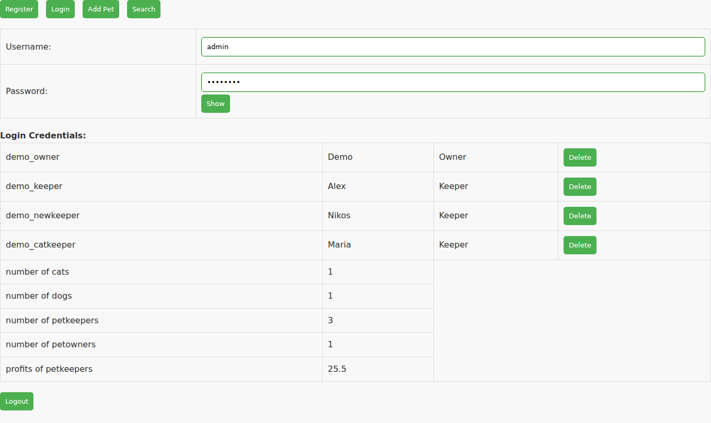
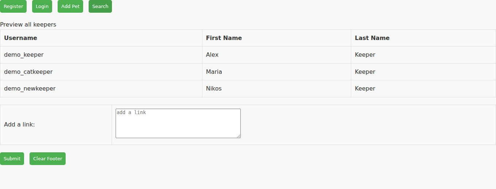
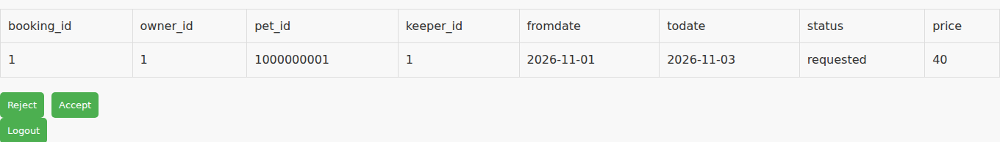
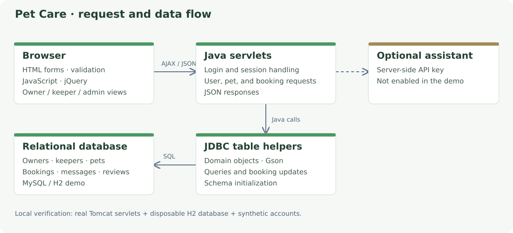

# Pet Care

A pet-sitting web application built as an individual project for the University of Crete HY359 web programming course. Owners register pets and request care bookings, keepers review requests, and an administrator views users and summary statistics.

**Java · Servlets · JDBC · MySQL · JavaScript · AJAX · jQuery · Maven**

[Technical brief report](docs/portfolio-report.pdf) · [Original course report (Greek)](docs/report.pdf) · [Setup and implementation notes](docs/SETUP.md)



*Admin dashboard from the running Java application, populated with fictional demo data.*

## What it demonstrates

- HTML forms with client-side validation and asynchronous JSON requests.
- Login/logout sessions and separate owner, keeper, and administrator views.
- A six-table relational model for owners, keepers, pets, bookings, messages, and reviews.
- JDBC queries for keeper availability, pending bookings, and administration statistics.
- Booking requests and keeper responses, with the browser updating the interface through AJAX.



*Visitor directory showing the keepers returned by the server.*



*Pending booking in the keeper view, with dates and accept/reject controls.*

## Run locally

Requires **JDK 17 and Maven 3.9+**:

```sh
mvn verify
mvn -Pdemo test-compile exec:java
```

Open **http://127.0.0.1:8080/pet-care/**. The demo runs the real servlets in embedded Tomcat with a disposable H2 database in MySQL mode. It needs no MySQL server or API credentials. Demo data resets when the process restarts.

| View | Username | Password |
| --- | --- | --- |
| Owner | `demo_owner` | `Demo123!` |
| Keeper | `demo_keeper` | `Demo123!` |
| Administrator | `admin` | `admin12*` |

Eight HTTP/JDBC integration tests cover the directory, login/logout, invalid login, booking retrieval, keeper availability, admin totals, foreign keys, and disabled maintenance/API routes. The screenshots come from browser interaction with this local demo. MySQL deployment and external APIs are separate from these checks.

This is a course prototype. Availability currently depends on booking status rather than date-overlap checks. Authorization, password handling, and several forms need further work before deployment. See the [implementation boundaries](docs/SETUP.md#implementation-boundaries).

## Design and documentation



- [`src/main`](src/main): servlet application, JDBC helpers, domain objects, and web interface.
- [`sql`](sql): schema and synthetic demo data.
- [`src/test`](src/test): embedded demo server and integration checks.
- [LaTeX sources](docs/portfolio-report/main.tex) · [Overleaf ZIP](docs/portfolio-report-overleaf.zip).
- [Earlier course report](docs/earlier-course-report.pdf): documentation from the earlier implementation.

Individual coursework by **Dimitrios Asimakopoulos**.
